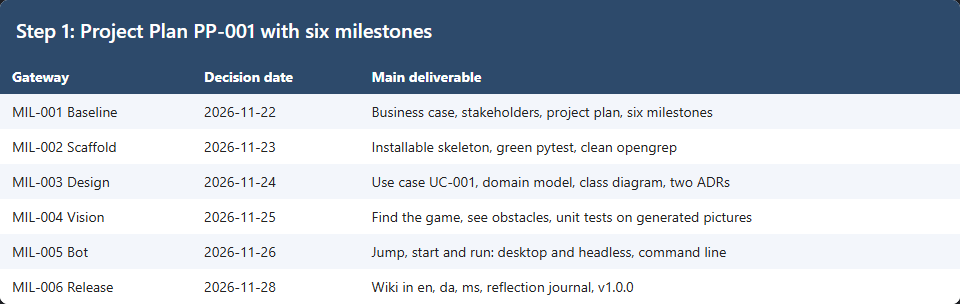
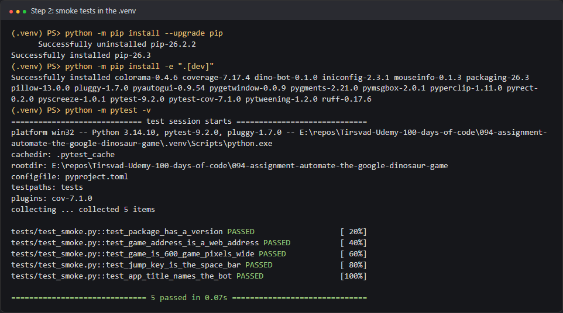
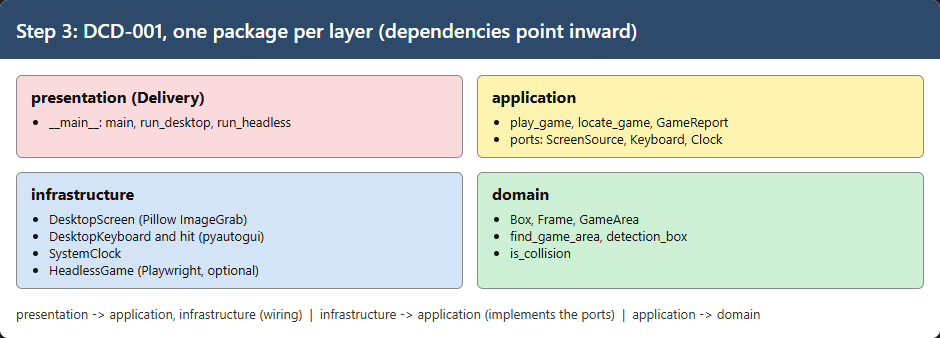
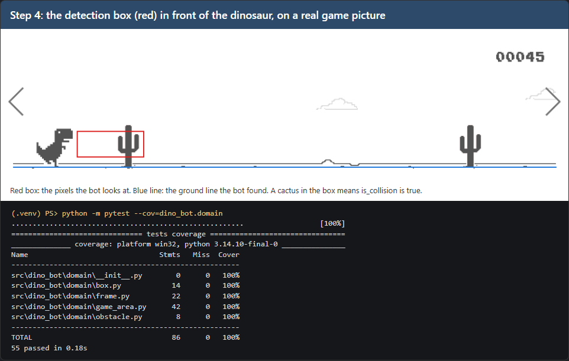
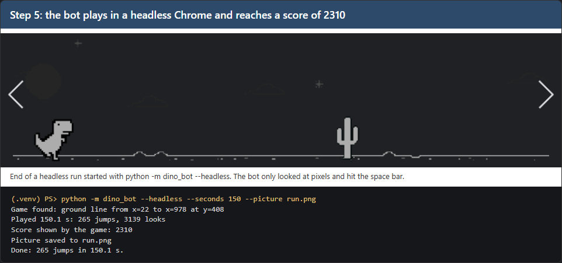
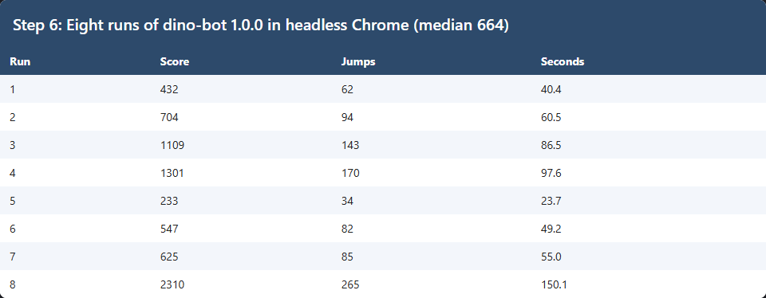

# 🚀 Dino Bot

A Python bot that plays the Google Dinosaur Game by itself: it looks at the
pixels of the screen with Pillow and hits the space bar with pyautogui. Day 94
assignment of the 100 Days of Code Python course.

## 📚 Table of Contents

- [Overview](#-overview)
- [Requirements](#-requirements)
- [Setup](#-setup)
- [Run](#-run)
- [Tests](#-tests)
- [Steps](#-steps)
- [License](#-license)
- [Links](#-links)
- [Appendix: Project documents](#-appendix-project-documents)

## 🧭 Overview

The assignment is to automate the hidden dinosaur game of Chrome
(<https://elgoog.im/t-rex/>) with a script that looks at the screen. This bot
does it in four moves:

1. It presses the space bar once to start the game.
2. It takes a screenshot and finds the game: the row with the most dark pixels
   is the ground line, and its width tells the scale of the screen.
3. It keeps taking small screenshots of a box just in front of the dinosaur.
   The box reaches further ahead as the game speeds up. When pixels in the box
   differ from the background, a cactus or a bird is coming (`is_collision`).
4. It hits the space bar (`hit`) and waits a moment before it may jump again.

It works at other screen scales and in night mode, because it measures the
scale and takes the most common grey value as the background.

| Folder | What it holds |
| --- | --- |
| `src/dino_bot/domain/` | `Box`, `Frame`, `GameArea`, `find_game_area` and `is_collision`: the rules, working on plain bytes |
| `src/dino_bot/application/` | The use case `play_game` and the ports for screen, keyboard and clock |
| `src/dino_bot/infrastructure/` | Pillow screenshots, pyautogui key presses (`hit`), the clock and a headless Chrome |
| `src/dino_bot/__main__.py` | The command line and the composition root |
| `src/dino_bot/constants.py` | Every constant: key, box size, game speed, delays |
| `tests/` | pytest tests; they use generated pictures and fakes and never use the screen, the keyboard or the network |
| `docs/` | Project documents; `docs/images/` holds the screenshots |

The table shows the finished layout: step 2 adds the package, `constants.py`
and a smoke test, step 4 the domain layer, and step 5 the application layer,
the adapters and the command line.

## 📋 Requirements

| Requirement | Why |
| --- | --- |
| Python 3.14 or newer | The language the project is written in |
| Pillow | Takes the screenshots and converts them to grey |
| PyAutoGUI | Hits the space bar |
| A desktop session and Google Chrome | The game runs in the browser; desktop mode needs a screen |
| pytest (development only) | Runs the tests |
| Playwright (optional, extra `headless`) | Plays in a headless Chrome so you can watch without using the desktop |
| Doxygen (optional) | Builds the API documentation from the source comments |

## 🛠️ Setup

Create a local virtual environment in `.venv`, upgrade pip, and install the
project with its test tools.

Linux and macOS:

```bash
python3 -m venv .venv
source .venv/bin/activate
python -m pip install --upgrade pip
python -m pip install -e ".[dev]"
```

Windows (PowerShell):

```powershell
py -3.14 -m venv .venv
.venv\Scripts\Activate.ps1
python -m pip install --upgrade pip
python -m pip install -e ".[dev]"
```

Leave the environment with `deactivate`. The `.venv` folder is in `.gitignore`.
For the headless mode add the extra: `python -m pip install -e ".[dev,headless]"`.

## ▶️ Run

With the virtual environment active, open <https://elgoog.im/t-rex/> in Chrome,
then start the bot and click on the game window before the countdown ends:

```bash
python -m dino_bot --countdown 5
```

Move the mouse to a corner of the screen to stop the bot (the pyautogui
fail-safe), or press `Ctrl+C`. Options:

| Option | Default | Meaning |
| --- | --- | --- |
| `--seconds N` | play on | Stop after N seconds |
| `--countdown N` | 3 | Seconds to wait before the start, to bring the game to the front |
| `--region L T R B` | whole screen | Search for the game only in this part of the screen |
| `--headless` | off | Play in a headless Chrome (needs the `headless` extra) instead of on the desktop |
| `--picture PATH` | none | Headless only: save a screenshot of the page at the end |
| `-v` | off | Log every jump |

`dino-bot` is a shortcut for `python -m dino_bot`. To watch the bot without
using the mouse and keyboard of your computer:

```bash
python -m dino_bot --headless --seconds 150 --picture run.png
```

## 🧪 Tests

```bash
python -m pytest
```

With coverage: `python -m pytest --cov=dino_bot`.

No test uses the screen, the keyboard or the network. The code that touches the
real screen and keyboard is a thin adapter and is checked by a headless run.

Build the API documentation (optional): run `doxygen` in the repository root and
open `docs/doxygen/html/index.html`.

## 🪜 Steps

The project is built in steps, one branch and pull request each. The wiki has a
page per step that explains what was learned, in English, Danish and Bahasa
Malaysia and a [reflection journal](docs/reflection.md).

<!-- steps:start -->
| Step | Milestone | What it adds | Screenshot | Wiki |
| --- | --- | --- | --- | --- |
| 1 | MIL-001 Baseline | Business case, stakeholders, project plan and milestones | [01-baseline.png](docs/images/01-baseline.png) | [Step 1](https://git.tirsystem.com/Tirsvad-Udemy-100-days-of-code/094-assignment-automate-the-google-dinosaur-game/wiki/Step-1-Baseline) |
| 2 | MIL-002 Scaffold | `pyproject.toml`, `constants.py`, smoke test, `.gitignore`, `.editorconfig`, `Doxyfile`, this README | [02-scaffold-tests.png](docs/images/02-scaffold-tests.png) | [Step 2](https://git.tirsystem.com/Tirsvad-Udemy-100-days-of-code/094-assignment-automate-the-google-dinosaur-game/wiki/Step-2-Scaffold) |
| 3 | MIL-003 Design | Use case UC-001, two ADRs, domain model and design class diagram | [03-design-class-diagram.png](docs/images/03-design-class-diagram.png) | [Step 3](https://git.tirsystem.com/Tirsvad-Udemy-100-days-of-code/094-assignment-automate-the-google-dinosaur-game/wiki/Step-3-Design) |
| 4 | MIL-004 Vision | `Box`, `Frame`, `find_game_area`, `detection_box`, `is_collision` and their unit tests | [04-vision-detection-box.png](docs/images/04-vision-detection-box.png) | [Step 4](https://git.tirsystem.com/Tirsvad-Udemy-100-days-of-code/094-assignment-automate-the-google-dinosaur-game/wiki/Step-4-Vision) |
| 5 | MIL-005 Bot | `play_game`, desktop and headless adapters, `hit`, the command line and their tests | [05-bot-headless-run.png](docs/images/05-bot-headless-run.png) | [Step 5](https://git.tirsystem.com/Tirsvad-Udemy-100-days-of-code/094-assignment-automate-the-google-dinosaur-game/wiki/Step-5-Bot) |
| 6 | MIL-006 Release | Wiki in three languages, reflection journal, final README, version 1.0.0 | [06-release-results.png](docs/images/06-release-results.png) | [Step 6](https://git.tirsystem.com/Tirsvad-Udemy-100-days-of-code/094-assignment-automate-the-google-dinosaur-game/wiki/Step-6-Release) |

Step 1, the Project Plan with six milestones:



Step 2, smoke tests passing in the .venv:



Step 3, the layers of the design:



Step 4, the detection box on a real game picture and the vision tests:



Step 5, a headless run of the bot with its score:



Step 6, results of three headless runs:


<!-- steps:end -->

## 📄 License

GNU Affero General Public License v3.0 or later, see [LICENSE](LICENSE).

## 🔗 Links

- [Repository][repository]
- [Documentation][documentation]
- [Issue tracker][issues]

## 📎 Appendix: Project documents

| Document | What it tells you |
| --- | --- |
| [Business Case][BC-001] | Why the project exists, its scope and success criteria |
| [Stakeholder Analysis][SA-001] | Who is involved; the stakeholder IDs used for owners and reviewers |
| [Project Plan][PP-001] | The gateways and their schedule |
| [Milestones][milestones] | One document per gateway: Go/No-Go criteria and tasks |
| [Artifact registry][registry] | Where each artifact type lives, the next version, the PO language and domain |
| [Framework README][framework-readme] | The framework this project uses |
| [Framework changelog][framework-changelog] | What changed in each framework release |

---

[repository]: https://git.tirsystem.com/Tirsvad-Udemy-100-days-of-code/094-assignment-automate-the-google-dinosaur-game
[documentation]: https://git.tirsystem.com/Tirsvad-Udemy-100-days-of-code/094-assignment-automate-the-google-dinosaur-game/wiki
[issues]: https://git.tirsystem.com/Tirsvad-Udemy-100-days-of-code/094-assignment-automate-the-google-dinosaur-game/issues
[BC-001]: ./docs/business-case.md
[SA-001]: ./docs/stakeholder-analysis.md
[PP-001]: ./docs/project-plan.md
[milestones]: ./docs/milestones/
[registry]: ./docs/artifact-registry.md
[framework-readme]: ./framework/README.md
[framework-changelog]: ./framework/CHANGELOG.md
