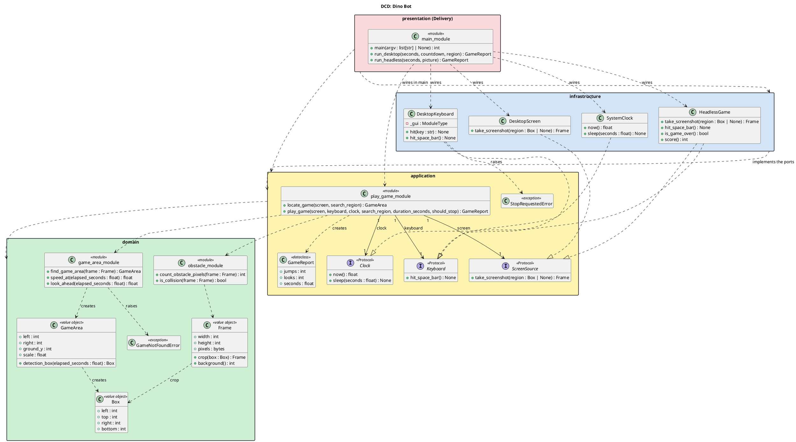

# Design Class Diagram: Dino Bot

## Metadata

| Key | Value |
| --- | --- |
| ID | DCD-001 |
| CrossReference | [DM-001], [UC-001], [ADR-0001], [ADR-0002] |

## Version History

| Date | Status | Author | Reviewer | Change | Commit |
| --- | --- | --- | --- | --- | --- |
| 2026-11-21 | Proposed | S01 | S01 | First edition | [4dabae9] |
| 2026-11-21 | Accepted | S01 | S01 | Accepted by S01 in chat on 2026-11-21; review RC-014 Go, stand-in, not independent | [4dabae9] |

---

## Purpose

The project Design Class Diagram: the classes, functions and packages that
implement [UC-001], one package per clean architecture layer. Answers CN-003
and CN-005 for S02 and S03.

## Diagram

## Mapping to the Domain Model

| Domain concept | Design element |
| --- | --- |
| Game | `Frame` (what the screen shows) and `speed_at` (how fast the game is after some seconds) |
| Ground Line | `GameArea` (`left`, `right`, `ground_y`), found by `find_game_area` |
| Dinosaur | `DINO_RIGHT` in `constants.py`: the right edge of the dinosaur in game pixels |
| Obstacle | The pixels counted by `count_obstacle_pixels` |
| Danger Zone | `GameArea.detection_box(elapsed_seconds)`, a `Box` |
| Jump | `Keyboard.hit_space_bar()`, counted in `GameReport.jumps` |

## Traceability to the use case

| Use case step | Design element |
| --- | --- |
| 2 Start the game | `Keyboard.hit_space_bar` called first in `play_game` |
| 3 Find the game | `locate_game`, `find_game_area` |
| 4 Look at the zone | `GameArea.detection_box`, `ScreenSource.take_screenshot` |
| 5 Jump | `is_collision`, `Keyboard.hit_space_bar`, the cool-down in `play_game` |
| 6 Repeat and stop | the loop of `play_game`, `duration_seconds`, `should_stop`, `StopRequestedError` |
| 7 Report | `GameReport` |

## Design Notes

- Dependencies point inward: `domain` imports nothing from the other layers;
  `application` owns the ports `ScreenSource`, `Keyboard` and `Clock`
  (dependency inversion); `infrastructure` implements them; `main` wires the
  parts (composition root).
- `is_collision` and `hit` carry the names the assignment uses.
- Every constant lives in `constants.py` (key, zone size, speeds, delays).
- Playwright and pyautogui are imported when their adapter is made, so the rest
  of the package and its tests work on a computer without them.
- No Operation Contract or Sequence Diagram is written: UC-001 is one short
  loop, and the table above traces each step to its design element. S01
  accepted this lean choice in BC-001 (one use case, lean artifacts).

---

[DM-001]: ./domain-model.md
[UC-001]: ./use-cases/uc-001-play-the-game/uc.md
[ADR-0001]: ./adr/adr-0001-pixels-with-pillow-and-pyautogui.md
[ADR-0002]: ./adr/adr-0002-detection-zone.md
[4dabae9]: https://git.tirsystem.com/Tirsvad-Udemy-100-days-of-code/094-assignment-automate-the-google-dinosaur-game/commit/4dabae906e79f285b289afcb93479a77852b0a3d
