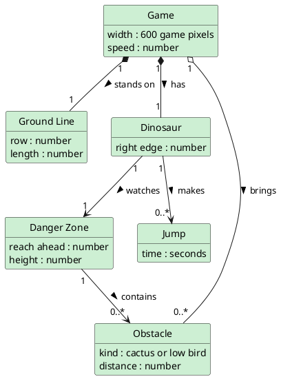

# Domain Model: Dino Bot

## Metadata

| Key | Value |
| --- | --- |
| ID | DM-001 |
| CrossReference | [UC-001] |
| Language | en |
| Domain | it |

## Version History

| Date | Status | Author | Reviewer | Change | Commit |
| --- | --- | --- | --- | --- | --- |
| 2026-11-21 | Proposed | S01 | S01 | First edition | [4dabae9] |
| 2026-11-21 | Accepted | S01 | S01 | Accepted by S01 in chat on 2026-11-21; review RC-013 Go, stand-in, not independent | [4dabae9] |

---

## Purpose

The project Domain Model: the concepts of the game in the student's words. It
answers CN-003 and CN-004 for S02, so the design and the code name things the
way a player talks about the game.

## Diagram

## Concepts

| Concept | Meaning | Source |
| --- | --- | --- |
| Game | The dinosaur game on the screen; it is 600 game pixels wide and speeds up as it goes on | UC-001 steps 2 and 3, BR-2 |
| Ground Line | The line the dinosaur runs on; the row with the most dark pixels, whose length gives the scale | UC-001 step 3, BR-2 |
| Dinosaur | The runner that must not touch an obstacle | UC-001 main scenario |
| Obstacle | A cactus or a low bird that comes towards the dinosaur | UC-001 steps 4 and 5 |
| Danger Zone | The part of the game in front of the dinosaur where an obstacle means jump now; it reaches further as the game speeds up | UC-001 step 4, BR-3, BR-4 |
| Jump | One leap of the dinosaur; a new one is allowed after a short rest | UC-001 step 5, BR-5 |

---

[UC-001]: ./use-cases/uc-001-play-the-game/uc.md
[4dabae9]: https://git.tirsystem.com/Tirsvad-Udemy-100-days-of-code/094-assignment-automate-the-google-dinosaur-game/commit/4dabae906e79f285b289afcb93479a77852b0a3d
